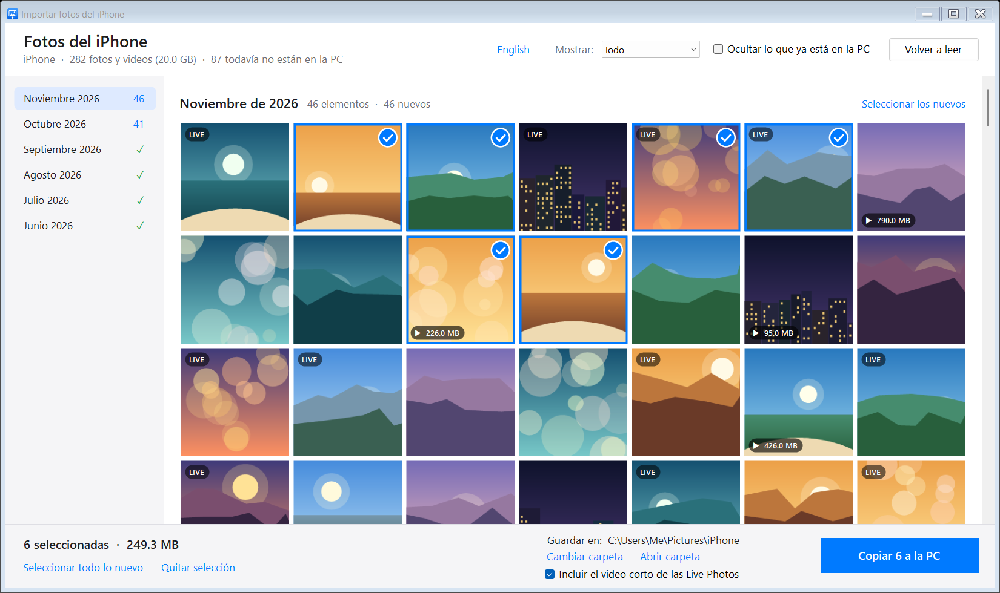

  

<h1 align="center">iPhone Photo Importer</h1>

  <b>Pasa fotos y videos de tu iPhone a una PC con Windows. Míralas, elige las que quieras y listo.</b> 
  <a href="README.md">Read in English</a>

Sacar las fotos de un iPhone en Windows es un dolor de cabeza: el Explorador no muestra todas las carpetas y la app Fotos tarda muchísimo en cargar. **iPhone Photo Importer** es una app pequeña y gratis que muestra todo lo que hay en tu iPhone como miniaturas, agrupado por mes, y copia solo lo que tú eliges.

## Qué hace

- **Ves todo**: cada foto y video como miniatura, agrupado por mes (lo más nuevo primero), con la lista de meses al costado para saltar rápido.
- **Eliges lo que quieres**: clic, Shift+clic para un rango, o "Seleccionar los nuevos" para un mes entero. Doble clic para verla en grande antes de decidir.
- **Solo copia lo nuevo**: recuerda lo que ya pasaste y lo marca con "✓ En la PC".
- **Ordenado por mes**: `Imágenes\iPhone\2026-11\IMG_1234.HEIC`, con la fecha en que se tomó cada foto.
- **Las Live Photos se ven una sola vez**, y su video corto se copia junto a la foto (opcional).
- **Segura**: comprueba que cada archivo llegue completo, nunca borra ni cambia nada en tu iPhone y nada sale de tu PC.
- **Si el iPhone se bloquea**, la copia se pausa y sigue sola cuando lo desbloqueas.
- **Te avisa cuando el iPhone esconde sus fotos más nuevas** y te explica cómo arreglarlo.
- **En español e inglés.**
- **Liviana**: un solo archivo de ~100 KB, sin instalador, sin internet, sin cuenta de Apple.

## Descarga

1. Entra a [**Releases**](https://github.com/androskent-cell/iphone-photo-importer/releases/latest) y descarga `iPhonePhotoImporter.exe`.
2. Ábrelo. Puede que Windows SmartScreen muestre un aviso porque la app no está firmada digitalmente: toca **Más información → Ejecutar de todas formas**. (O [compílala tú mismo](#compilarla-tú-mismo).)

Necesita Windows 10 u 11 (usa .NET Framework 4.8, que ya viene con Windows).

## Cómo se usa

1. Conecta tu iPhone con el cable USB y desbloquéalo. Toca **Confiar** si te lo pregunta.
2. Abre la app. Los meses empiezan a aparecer enseguida; la primera lectura después de conectarlo puede tardar unos minutos si tienes muchas fotos.
3. Toca las fotos y videos que quieras y luego **Copiar a la PC**.

> **Consejo:** para copias grandes, pon el bloqueo automático en *Nunca* (Ajustes → Pantalla y brillo) para que el iPhone no se bloquee a mitad de la copia. Si se bloquea, la app espera y sigue cuando lo desbloqueas.

## Problemas comunes

**No aparece el iPhone.** Desbloquéalo y toca *Confiar*. Si tampoco aparece en *Este equipo* en el Explorador, instala **Apple Devices** (o iTunes) desde la Microsoft Store para tener el controlador USB de Apple.

**Faltan mis fotos más nuevas.** A veces el iPhone se queda con una lista vieja de lo que comparte por el cable. La app muestra un aviso cuando parece que pasa esto. Se arregla en el iPhone:

1. Reinicia el iPhone, vuelve a conectarlo y toca **Volver a leer**.
2. Si no basta: *Ajustes → General → Transferir o restablecer iPhone → Restablecer → Restablecer localización y privacidad*. No borra fotos ni datos; las apps te volverán a pedir permisos y tendrás que tocar *Confiar* otra vez.

**Fotos de iCloud con "Optimizar almacenamiento".** Los originales que solo están en iCloud no están en el teléfono, así que no se pueden copiar por el cable. Descárgalos desde [icloud.com/photos](https://www.icloud.com/photos) o con iCloud para Windows.

**No puedo abrir las fotos .HEIC o los videos del iPhone.** Instala las *Extensiones de imagen HEIF* (gratis) desde la Microsoft Store (algunos videos también necesitan las *Extensiones de video HEVC*). O configura el iPhone en *Ajustes → Fotos → Transferir a Mac o PC → Automático* para recibir JPG (copia más lento).

## Compilarla tú mismo

No necesitas Visual Studio: ejecuta **`build.bat`**. Usa el compilador de C# que ya viene con Windows y crea `iPhonePhotoImporter.exe`.

Cómo funciona: habla con el iPhone a través del Shell de Windows (`IShellItem`, `IShellItemImageFactory`, `IFileOperation`) por la conexión de dispositivos portátiles del iPhone, el mismo camino que usa el Explorador, pero leyendo solo lo necesario.

`iPhonePhotoImporter.exe --demo` abre la app con fotos de ejemplo (así se hicieron las capturas).

## Licencia

[MIT](LICENSE) © Andros Blandon

Sin relación con Apple. iPhone es una marca registrada de Apple Inc.

Si te ahorró un dolor de cabeza, una ⭐ ayuda a que más gente la encuentre.
