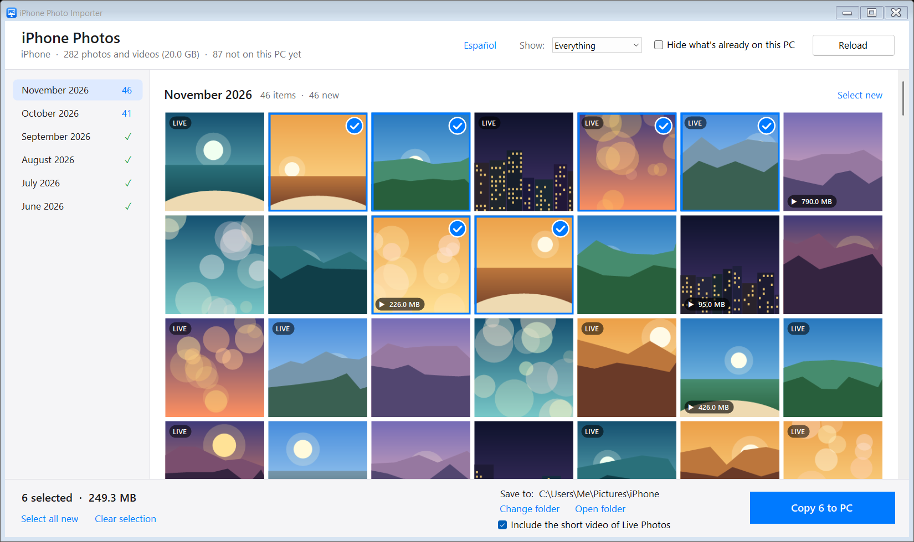

  

<h1 align="center">iPhone Photo Importer</h1>

  <b>Copy photos and videos from your iPhone to a Windows PC. See them, pick what you want, done.</b> 
  <a href="README.es.md">Leer en español</a>

Getting photos off an iPhone on Windows is a pain: File Explorer doesn't show every folder, and the Photos app takes forever to load. **iPhone Photo Importer** is a small, free app that shows everything on your iPhone as thumbnails, grouped by month, and copies only what you choose.

## Features

- **See everything**: every photo and video as a thumbnail, grouped by month (newest first), with a month list to jump around.
- **Pick what you want**: click, Shift+click for a range, or "Select new" for a whole month. Double-click to view it full size first.
- **Only copies what's new**: it remembers what you already imported and marks it "✓ On PC".
- **Organized by month**: `Pictures\iPhone\2026-11\IMG_1234.HEIC`, keeping the date each photo was taken.
- **Live Photos shown once**, with their short video copied alongside (optional).
- **Safe**: every file is checked to arrive complete, nothing on your iPhone is ever deleted or changed, and nothing leaves your PC.
- **Handles a locked iPhone**: the copy pauses and resumes when you unlock it.
- **Warns you when the iPhone hides its newest photos** and explains how to fix it.
- **English and Spanish.**
- **Tiny**: one ~100 KB file, no installer, no internet, no Apple account.

## Download

1. Go to [**Releases**](https://github.com/androskent-cell/iphone-photo-importer/releases/latest) and download `iPhonePhotoImporter.exe`.
2. Run it. Windows SmartScreen may warn you because the app isn't code-signed: click **More info → Run anyway**. (Or [build it yourself](#build-from-source).)

Requires Windows 10 or 11 (it uses .NET Framework 4.8, which is already part of Windows).

## How to use

1. Connect your iPhone with a USB cable and unlock it. Tap **Trust** if it asks.
2. Open the app. Months start appearing right away; the first read after plugging in can take a few minutes on large libraries.
3. Click the photos and videos you want, then **Copy to PC**.

> **Tip:** for big copies, set Auto-Lock to *Never* (Settings → Display & Brightness) so the iPhone doesn't lock mid-copy. If it does, the app waits and continues when you unlock it.

## Troubleshooting

**The iPhone doesn't show up.** Unlock it and tap *Trust*. If it doesn't appear under *This PC* in File Explorer either, install **Apple Devices** (or iTunes) from the Microsoft Store to get Apple's USB driver.

**My newest photos are missing.** Sometimes the iPhone keeps an outdated list of what it shares over USB. The app shows a warning when this seems to be happening. It has to be fixed on the iPhone:

1. Restart the iPhone, reconnect it and click **Reload**.
2. If that's not enough: *Settings → General → Transfer or Reset iPhone → Reset → Reset Location & Privacy*. It doesn't delete photos or data; apps will ask for permissions again and you'll need to tap *Trust* again.

**iCloud Photos with "Optimize iPhone Storage".** Originals that only live in iCloud aren't on the phone, so they can't be copied over USB. Download them from [icloud.com/photos](https://www.icloud.com/photos) or with iCloud for Windows.

**I can't open .HEIC photos or iPhone videos.** Install the free *HEIF Image Extensions* from the Microsoft Store (some videos also need *HEVC Video Extensions*). Or set the iPhone to *Settings → Photos → Transfer to Mac or PC → Automatic* to get JPGs (slower to copy).

## Build from source

No Visual Studio needed: run **`build.bat`**. It uses the C# compiler that ships with Windows and creates `iPhonePhotoImporter.exe`.

How it works: it talks to the iPhone through the Windows Shell (`IShellItem`, `IShellItemImageFactory`, `IFileOperation`) over the iPhone's Windows Portable Devices connection, the same path File Explorer uses, but reading only what's needed. Code comments are in Spanish.

`iPhonePhotoImporter.exe --demo` opens the app with sample pictures (that's how the screenshots were made).

## License

[MIT](LICENSE) © Andros Blandon

Not affiliated with Apple. iPhone is a trademark of Apple Inc.

If this saved you a headache, a ⭐ helps other people find it.
